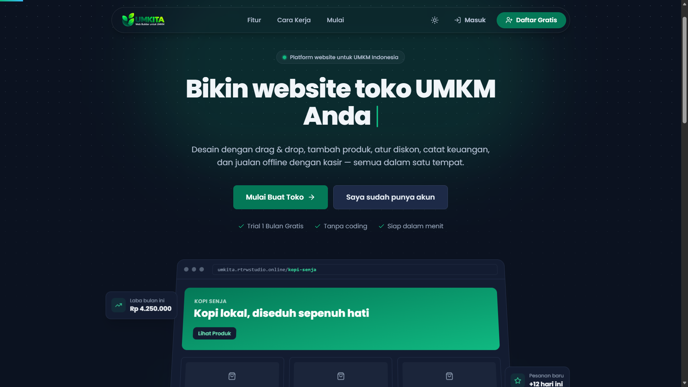

# Project Title

A brief description of what this project does and who it's for

# UMKM Web Builder



Platform pembuat website toko UMKM (SaaS) - satu dashboard untuk build website toko tanpa coding, kelola produk & diskon, pencatatan keuangan, dan kasir offline (POS).

`umkm.rtrwstudio.online`

---

## Daftar Isi

1. [Deskripsi Aplikasi](#deskripsi-aplikasi)
2. [Instalasi & Jalankan](#instalasi--jalankan)
3. [Setup Akun Admin Platform](#setup-akun-admin-platform)
4. [Teknologi & Tech Stack](#teknologi--tech-stack)
5. [Fitur Utama](#fitur-utama)
6. [Script](#script)
7. [Rute](#rute)
8. [Alur Kerja](#alur-kerja)
9. [Deploy ke Production](#deploy-ke-production)
10. [Keamanan & Row Level Security](#keamanan--row-level-security)
11. [Catatan & Known Issues](#catatan--known-issues)

---

## Deskripsi Aplikasi

UMKM Web Builder adalah platform SaaS all-in-one untuk pelaku UMKM di Indonesia. Setiap pengguna terdaftar, membuat satu toko, lalu mendapat:

- Website publik yang dapat diakses pada `/{slug}`
- Web builder berbasis drag & drop untuk menyusun halaman toko tanpa coding
- Dashboard toko untuk mengelola produk, diskon, dan keuangan
- Kasir offline (POS) untuk transaksi tunai, QRIS, dan transfer
- Panel admin platform untuk mengelola seluruh toko dan pengguna

Bahasa antarmuka adalah Indonesia, mata uang Rupiah, dan zona waktu Asia/Jakarta. Domain platform saat ini adalah `umkm.rtrwstudio.online` (contoh toko: `umkm.rtrwstudio.online/nama-toko`).

Prinsip desainnya mobile-first, bahasa sederhana tanpa jargon, umpan balik instan, dan empty state yang informatif. Gaya visual bersih dan modern: Tailwind CSS, rounded corners, bayangan halus, aksen brand emerald.

---

## Instalasi & Jalankan

```bash
npm install && cp .env.example .env && npm run dev
```

Browser terbuka di `http://localhost:5173`.

### 1. Install dependensi

```bash
npm install
```

### 2. Setup Supabase

Buka *SQL Editor* di Supabase, lalu jalankan seluruh isi `supabase/schema.sql` (tabel, trigger, RLS, fungsi kasir atomik, bucket storage `store-assets`), dilanjutkan dengan seluruh file di `supabase/migrations/`.

```bash
# Skema utama
supabase/schema.sql
# Migrasi (urut):
supabase/migrations/20261028_account_profile.sql
supabase/migrations/20261107_admin_no_store.sql
supabase/migrations/20261108_google_profile_sync.sql
supabase/migrations/20261108_onboarding_state.sql
```

**Otomatisasi (opsional)** - jika sudah menginstall CLI Supabase:

```bash
npx supabase link --project-ref <REF_PROYEK_ANDA>
npx supabase db push
```

### 3. Isi environment

```bash
cp .env.example .env
# VITE_SUPABASE_URL     - Supabase > Project Settings > API > Project URL
# VITE_SUPABASE_ANON_KEY - Supabase > Project Settings > API > anon public key
# VITE_PLATFORM_DOMAIN  - umkm.rtrwstudio.online (prod), localhost:5173 (dev)
```

### 4. Jalankan

```bash
npm run dev
```

---

## Setup Akun Admin Platform
akun admin yang tersedia:

- id: umkita.id@gmail.com
- pw: admin123

1. Daftar akun lewat `/register`.
2. Di SQL Editor, naikkan role:
   ```sql
   update public.profiles set role = 'admin' where email = 'email-anda@gmail.com';
   ```
3. Setelah itu `/admin` bisa diakses.

> **Catatan:** akun admin tidak boleh memiliki toko (dicegah trigger database).

> **Dev:** matikan *Confirm email* di Supabase > Authentication > Providers > Email agar bisa langsung login setelah daftar.

---

## Tech Stack

| Lapisan | Teknologi |
|---|---|
| UI framework | React 18 (`react`, `react-dom`) |
| Build tool | Vite 5 |
| Bahasa | JavaScript / JSX (ES modules, tanpa TypeScript) |
| Styling | Tailwind CSS 3 + PostCSS + Autoprefixer |
| Routing | React Router DOM 6 |
| Backend / BaaS | Supabase (`@supabase/supabase-js`) - Auth, PostgreSQL, Storage |
| Drag & drop | @dnd-kit (`core`, `sortable`, `utilities`) |
| Grafik | Recharts |
| Peta | Leaflet + React Leaflet |
| Ikon | Lucide React + React Icons |
| Notifikasi | React Hot Toast |
| Deployment | Static SPA (Vercel, Netlify, Cloudflare Pages, Nginx) |

---

## Fitur Utama

- **Landing Page** - hero, grid fitur, ajakan bertindak
- **Autentikasi** - email/password + OTP, Google OAuth, forgot/reset password
- **Web Builder** - editor drag & drop berbasis section (Hero, Tentang Kami, Produk, Galeri, Testimoni, Kontak), preview real-time desktop/mobile, publish
- **Dashboard Toko** - ringkasan statistik, grafik 7 hari, stok menipis, transaksi terakhir
- **Produk** - CRUD produk & kategori, upload gambar, stok, harga modal
- **Diskon** - persen/nominal, per produk atau seluruh toko, rentang tanggal
- **Keuangan** - pencatatan pemasukan/pengeluaran, kategori, grafik, ekspor CSV
- **Langganan** - Basic/Bisnis/Pro, trial 30 hari, meter penggunaan, manajemen paket
- **Kasir (POS)** - katalog produk, keranjang, diskon otomatis, Tunai/QRIS/Transfer, struk nota
- **Admin Platform** - kelola toko & pengguna, statistik, status langganan, pendapatan
- **Storefront** - website publik toko di `/{slug}`, tema menyesuaikan pengaturan toko

---

## Script

| Script | Fungsi |
|---|---|
| `npm run dev` | Development server (port 5173) |
| `npm run build` | Build produksi - output `dist/` |
| `npm run preview` | Preview hasil build |

---

## Rute

| Rute | Fungsi | Akses |
|---|---|---|
| `/` | Landing page platform | Publik |
| `/login`, `/register` | Auth (email/password + OTP, Google OAuth) | Publik |
| `/lupa-password`, `/reset-password` | Reset password | Publik |
| `/onboarding` | Wizard 3 langkah (buat toko - pilih paket) | Pemilik toko |
| `/builder`, `/builder/tema` | Web builder drag & drop + galeri tema | Pemilik toko |
| `/dashboard`, `/dashboard/*` | Dashboard toko: ringkasan, produk, diskon, keuangan, langganan, profil, pengaturan | Pemilik toko |
| `/pos` | Kasir offline | Pemilik toko |
| `/admin`, `/admin/pengguna`, `/admin/langganan`, `/admin/pembelian`, `/admin/pertumbuhan` | Admin panel platform | Admin platform |
| `/:slug` | Website publik toko, contoh `/toko-umkm-a` | Publik |

---

## Alur Kerja

1. UMKM daftar - wizard onboarding (buat toko: nama + slug; pilih paket trial 30 hari).
2. **Web Builder**: tambah/urutkan section (Hero, Tentang Kami, Produk, Galeri, Testimoni, Kontak) via drag & drop, edit teks/warna/gambar, preview real-time (desktop/mobile), klik **Publish**.
3. **Dashboard Toko**: kelola produk & kategori, buat diskon (persen/nominal). Produk aktif otomatis tampil di section Produk pada `/:slug`.
4. **Keuangan**: catat pemasukan/pengeluaran, grafik bulanan & per kategori, ekspor CSV.
5. **Kasir**: pilih produk, diskon dihitung otomatis, bayar Tunai/QRIS/Transfer. Satu panggilan RPC `create_pos_transaction` menyimpan transaksi, mengurangi stok, dan mencatat pemasukan ke keuangan secara atomik.

---

## Deploy ke Production

```bash
npm run build   # output ke dist/
```

Hosting SPA apa pun (Vercel, Netlify, Cloudflare Pages, Nginx). Semua path harus di-rewrite ke `index.html` - file `vercel.json` dan `public/_redirects` sudah disertakan.

Langkah deploy:

1. Set `VITE_PLATFORM_DOMAIN=umkm.rtrwstudio.online`.
2. Deploy folder `dist/` ke hosting.
3. Arahkan DNS subdomain `umkm` ke hosting.
4. Di Supabase > Authentication > URL Configuration, tambahkan `https://umkm.rtrwstudio.online` (dan URL redirect `/reset-password`, `/dashboard/pengaturan`) sebagai Site URL.

---

## Keamanan & Row Level Security

- Semua tabel memakai **Row Level Security (RLS)**: toko hanya bisa dibaca publik jika `is_published` **dan** `is_active`.
- Data keuangan & transaksi hanya untuk pemilik toko (admin dapat membaca).
- Slug ditolak jika bentrok dengan rute sistem (`login`, `admin`, `dashboard`, `builder`, `pos`, `onboarding`, dll.).
- Slug **immutable** setelah toko dibuat.
- Kunci `anon` aman dipakai di frontend; **jangan pernah** memakai `service_role` di kode frontend.
- `.env` diabaikan Git - jangan di-commit.

---

## Catatan & Known Issues

- **Tidak ada pembayaran sungguhan** - checkout langganan hanya mencatat invoice (simulasi client-side).
- Status langganan & onboarding disimpan di `stores.theme` (JSONB), bukan tabel khusus.
- New store mendapat **trial Basic 30 hari** (tidak ada paket gratis).
- Akun `expired` dibatasi maksimal 4 section di builder.
- RPC `is_email_registered` dipakai saat registrasi; harus sudah ada di project Supabase (tidak ada di `schema.sql`).
- Menambah section type baru memerlukan migration SQL (ada CHECK constraint di DB).
- `PROJECT.md` dan `README.md` dapat terlambat dibanding fitur terbaru (onboarding, langganan, galeri tema, guard admin).
